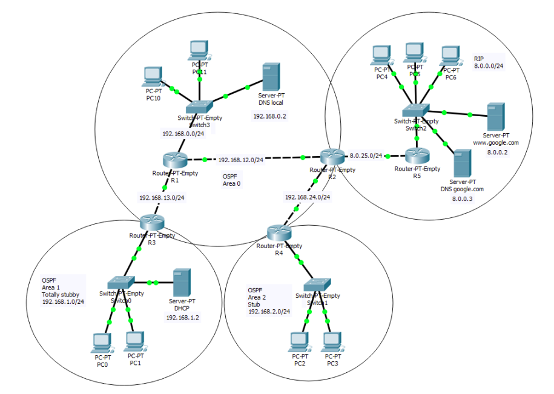

# Computer Networks Project - Cisco Packet Tracer Implementation

A comprehensive implementation and configuration of a complex hybrid computer network in **Cisco Packet Tracer**, combining multiple routing protocols, dynamic services, security policies, and network management tools.

---

---

## 🌐 Network Architecture & Topology

The network is split into two distinct routing domains connected via a border router:
- **OSPF Segment:** An advanced routing domain divided into three areas:
  - **Area 0 (Backbone):** Connects core routers and the primary network infrastructure.
  - **Area 1 (Totally Stubby Area):** Optimized zone managed by ABR.
  - **Area 2 (Stub Area):** Optimized zone for reduced routing table overhead.
- **RIP Segment:** A simpler downstream network segment utilizing the RIPv2 protocol.

---

## 🛠️ Key Features & Configurations

* **IP Addressing:** Precise static and dynamic assignment across all device interfaces, point-to-point (P2P) serial links, servers, and end hosts based on structured subnetting rules.
* **Dynamic Host Configuration Protocol (DHCP):** 
  - Configured dedicated DHCP server in OSPF Area 1 to dynamically assign IP parameters to local hosts.
  - Configured DHCP server directly on router `R5` for the RIP segment (`8.0.0.0/24`), excluding specific restricted address ranges.
* **Routing Protocols:**
  - **OSPFv2:** Configured across core routers with multi-area characteristics and optimized stub/totally stubby area flags.
  - **RIPv2:** Configured on the RIP segment routers with disabled auto-summary.
* **Route Redistribution:** Implemented on the boundary router between RIP and OSPF domains to ensure seamless bi-directional connectivity:
  - RIP to OSPF redistribution using metric **25** and metric-type **E1** (External Type 1) to keep metrics cumulative across the OSPF domain.
  - OSPF to RIP redistribution using metric **1** (hop count).
* **DNS and Web Services:** Setup of local DNS servers with domain resolution and forwarding capabilities (e.g., resolving `.com` domains and `google.com`), allowing end users to access web servers seamlessly by name.
* **Security & Access Control (ACL):** Advanced Extended Access Control Lists deployed on routers to tightly restrict traffic:
  - Restricting DNS servers to process only DNS queries.
  - Allowing web servers to accept only HTTP traffic and ICMP Echo Requests (`ping`).
  - Granting ICMP access across the RIP segment while explicitly protecting critical infrastructure.
* **Remote Administration:** Enabled and secured remote router management using the **Telnet** protocol protected by passwords.

---

## 🚀 Technologies & Tools
* **Simulation Software:** Cisco Packet Tracer
* **Protocols:** OSPFv2, RIPv2, DHCP, DNS, TCP/IP, ICMP, Telnet, Extended ACL
